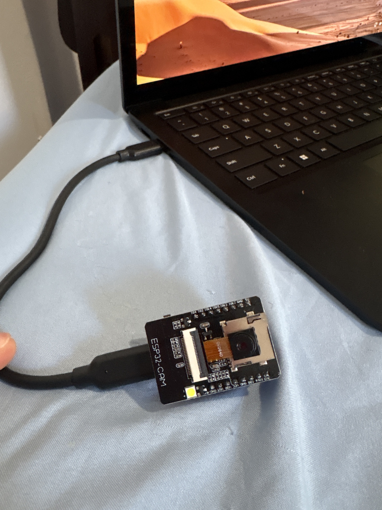

# ESP32-CAM Camera Access Point

I used an AI Thinker ESP32-CAM to create a Wi-Fi network and stream video directly to my phone. Once the phone joined the board's network, I could open the camera page without using a router.

## Hardware and tools

- AI Thinker ESP32-CAM
- Arduino IDE with the Espressif ESP32 board package
- USB-to-serial connection (COM4 in my setup)
- Phone with Wi-Fi and a web browser

## Setup

1. Open [AccessPoint_CameraWebServer.ino](sketches/AccessPoint_CameraWebServer/AccessPoint_CameraWebServer.ino) in Arduino IDE.
2. Select **AI Thinker ESP32-CAM** and the serial port for your board. The sketch includes the AI Thinker camera pin configuration and a partition table.
3. Set the Wi-Fi network name and replace the example password with your own password of at least eight characters, then upload the sketch.
4. Open Serial Monitor at **115200 baud** and press Reset if you missed the startup output.
5. Join the ESP32-CAM network on your phone, open `http://192.168.4.1` in the browser, and select **Start Stream**.

The sketch uses `WiFi.softAP()` to start the board's Wi-Fi network. It then starts the camera server and prints the board's address using `WiFi.softAPIP()`.

## Testing and results

| What I checked | Evidence |
|---|---|
| Serial Monitor printed the camera URL | [Serial Monitor](evidence/screenshots/serial-monitor.jpg) |
| The phone browser showed the live camera stream at `192.168.4.1` | [Live stream](evidence/screenshots/live-stream.jpg) |

## Troubleshooting

The Serial Monitor was blank the first time I opened it. I pressed Reset with the monitor open, and the board printed its startup messages and the camera URL.

## References

- [Espressif CameraWebServer example](https://github.com/espressif/arduino-esp32/tree/master/libraries/ESP32/examples/Camera/CameraWebServer)
- [ESP32-CAM access point guide](https://randomnerdtutorials.com/esp32-cam-access-point-ap-web-server/)
